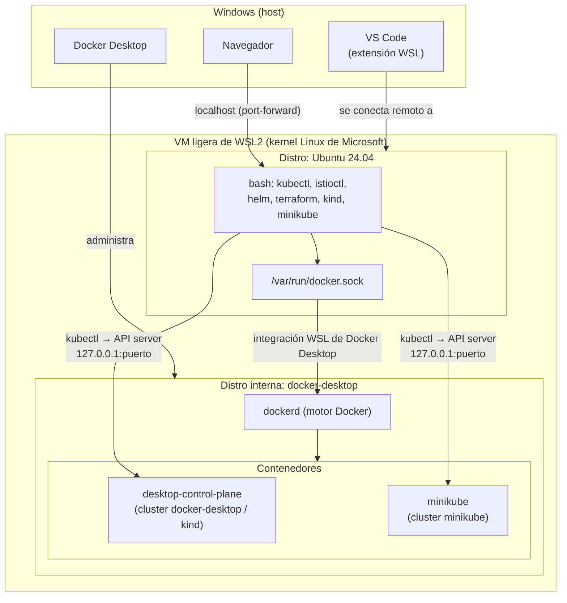

# Entorno local: Windows + WSL2 + Docker + Kubernetes

Cómo está armado mi laboratorio y por qué funciona como funciona.

---

## 1. La foto completa



**En resumen:** todo lo de Linux corre dentro de una VM ligera de WSL2. Docker Desktop
mete su motor en esa misma VM, y cada cluster de Kubernetes es solo **un contenedor
Docker** que hace el papel de "nodo".

---

## 2. WSL2

- **WSL2** (Windows Subsystem for Linux) corre un **kernel Linux real** dentro de una VM
  ligera de Hyper-V. Cada distro (Ubuntu, etc.) es un contenedor aislado dentro de esa VM.
- Desde Windows, el disco de Ubuntu se ve en `\\wsl$\Ubuntu\home\axelrivera`.
- Desde Ubuntu, los discos de Windows se ven en `/mnt/c/...`.
- Mi distro tiene `systemd=true` en `/etc/wsl.conf`.
- `localhost` se comparte: un puerto que abro en WSL (por ejemplo con `kubectl
  port-forward 8080:80`) se puede abrir en el navegador de Windows como
  `http://localhost:8080`.

```powershell
# En PowerShell (Windows)
wsl -l -v                 # distros y versión de WSL
wsl --shutdown            # apaga la VM completa (útil si algo se cuelga)
```

### VS Code + WSL
VS Code corre la interfaz en Windows y un "servidor" dentro de WSL. Por eso la terminal,
los archivos y las herramientas son los de Ubuntu.

---

## 3. Docker Desktop y la integración con WSL

- Docker Desktop corre el motor (`dockerd`) en su propia distro interna (`docker-desktop`).
- Con **Settings → Resources → WSL Integration → Ubuntu** activado, Docker Desktop expone el
  socket `/var/run/docker.sock` dentro de mi Ubuntu. Por eso el comando `docker` de WSL habla
  con el motor de Windows: **no tengo Docker instalado "nativo" en Ubuntu**.

```bash
docker context ls     # default → unix:///var/run/docker.sock
docker ps             # aquí se ven los "nodos" de los clusters
```

Si `docker` no responde en WSL, revisa que Docker Desktop esté abierto y que la integración
WSL esté activada.

---

## 4. Kubernetes local: tres formas

Las tres crean clusters donde **los nodos son contenedores Docker**.

| | Docker Desktop K8s | kind | minikube |
|---|---|---|---|
| Qué es | K8s integrado en Docker Desktop | "Kubernetes IN Docker": cada nodo es un contenedor | Herramienta para clusters locales con varios drivers (docker, hyperv, etc.) |
| Cómo se crea | Settings → Kubernetes → Enable | `kind create cluster` | `minikube start` |
| Contexto kubectl | `docker-desktop` | `kind-<nombre>` | `minikube` |
| Nodo(s) | `desktop-control-plane` | `<nombre>-control-plane`, `-worker`... | `minikube` |
| Multinodo | Sí (en modo kind) | Sí, con un archivo de config | Sí (`--nodes`) |
| Addons | No | No | Sí (`minikube addons`) |
| LoadBalancer | Le da una IP de la red de Docker | Necesita MetalLB o cloud-provider-kind | `minikube tunnel` |

### 4.1 Mi cluster de Docker Desktop
Docker Desktop tiene dos modos de provisión: **kubeadm** (un solo nodo) y **kind**
(multinodo). El mío usa **kind**, por eso el nodo se llama `desktop-control-plane`.

> `kind get clusters` dice *"No kind clusters found"* porque este cluster lo administra
> Docker Desktop, no el binario `kind`. Es normal.

### 4.2 kind (cuando quiera clusters desechables)

```bash
kind create cluster --name lab
kind get clusters
kubectl config use-context kind-lab
kind delete cluster --name lab
```

Ejemplo multinodo (`kind-config.yaml`):

```yaml
kind: Cluster
apiVersion: kind.x-k8s.io/v1alpha4
nodes:
  - role: control-plane
  - role: worker
  - role: worker
```

```bash
kind create cluster --name lab --config kind-config.yaml
```

### 4.3 minikube

```bash
minikube start --driver=docker --cpus=4 --memory=8192
minikube status
minikube stop
minikube delete
minikube addons list
minikube dashboard
minikube tunnel            # para servicios LoadBalancer (déjalo corriendo)
minikube update-context    # corrige el puerto en el kubeconfig
```

> Maneja minikube **siempre desde el mismo lado** (WSL *o* Windows). Si lo arrancas con
> `C:\Kubernetes\minikube.exe`, se actualiza el kubeconfig de Windows
> (`C:\Users\<usuario>\.kube\config`), no el de WSL (`~/.kube/config`).

---

## 5. kubeconfig y contextos

`kubectl` lee `~/.kube/config`. Ese archivo tiene:
- **clusters**: la URL del API server y el certificado CA.
- **users**: las credenciales.
- **contexts**: combinaciones de cluster + usuario + namespace.
- **current-context**: el contexto que se usa por defecto.

```bash
kubectl config get-contexts
kubectl config current-context
kubectl config use-context docker-desktop
kubectl config set-context --current --namespace=istio-system   # cambiar el namespace por defecto
kubectl config view --minify                                     # ver solo el contexto activo
```

El API server de cada cluster se publica en `127.0.0.1:<puerto aleatorio>`, que Docker
mapea al puerto 6443/8443 del contenedor-nodo:

```bash
docker ps --format '{{.Names}}\t{{.Ports}}'
```

---

## 6. Problemas que me pasaron

### `connection refused 127.0.0.1:57772` (26-oct-2026)
- **Causa:** el contexto activo era `minikube`. Su contenedor se había reiniciado, el API
  ahora estaba en el puerto `58780` y el kubelet estaba detenido.
- **Solución:** para trabajar, cambié a `kubectl config use-context docker-desktop`. Para
  arreglar minikube: `minikube update-context && minikube start`.

### `curl ... | sh` bloqueado
- En lugar de correr scripts remotos, descargué el tarball oficial de la release desde
  GitHub y lo extraje (ver [istio](../istio/README.md)).
