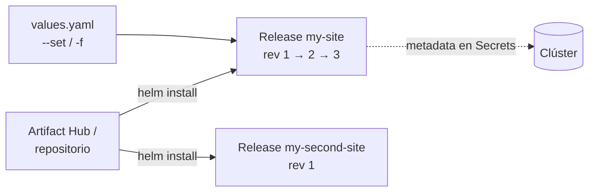

# Helm: conceptos y comandos

## ¿Por qué Helm?

Una app "simple" como WordPress en Kubernetes son muchos objetos: Deployment, PV, PVC,
Service, Secret… Sin Helm hay que crear, editar, actualizar y borrar cada YAML a mano y
acordarse de cuáles van juntos.

Helm trata la app como un **paquete**: la instalas, la actualizas, la regresas a una versión
anterior y la desinstalas con un solo comando. Además, separa la configuración
(`values.yaml`) de las plantillas.

## Conceptos

| Concepto | Qué es |
|---|---|
| **Chart** | El paquete: carpeta con templates + `values.yaml` + `Chart.yaml` |
| **Repository** | Lugar donde se publican charts (Bitnami, etc.). **Artifact Hub** es el buscador central. |
| **Release** | Una **instalación** concreta de un chart en el clúster. El mismo chart se puede instalar varias veces con nombres distintos (`my-site`, `my-second-site`). |
| **Revision** | Cada cambio en un release (install, upgrade, rollback) crea una revisión nueva. |
| **Metadata** | Helm guarda la información de cada release como **Secrets** dentro del clúster, en el namespace del release. Así otro miembro del equipo puede ver su historial. |



## Helm 2 vs Helm 3+

- Helm 2 tenía **Tiller**, un componente dentro del clúster con permisos de admin (problema
  de seguridad). Helm 3 lo eliminó: ahora usa los permisos de tu kubeconfig (RBAC).
- Helm 3 hace un **3‑way strategic merge patch**: compara el chart anterior, el nuevo y **el
  estado real del clúster**. Si alguien cambió algo a mano con `kubectl`, un rollback lo
  detecta y lo corrige.
- `apiVersion: v2` en `Chart.yaml` = chart de Helm 3+. `v1` era Helm 2.

## Instalar y personalizar

```bash
helm repo add bitnami https://charts.bitnami.com/bitnami
helm search repo wordpress
helm install my-release bitnami/wordpress

# Personalizar valores
helm install my-release bitnami/wordpress --set wordpressBlogName="Helm Tutorials"
helm install my-release bitnami/wordpress -f custom-values.yaml

# O bajar el chart y editar su values.yaml
helm pull bitnami/wordpress --untar     # crea la carpeta ./wordpress
helm install my-release ./wordpress
```

> ⚠️ Corrección respecto a las notas: `helm pull --untar` es la forma de bajar **y
> descomprimir**. Sin `--untar` solo deja el `.tgz`.

## Lifecycle: upgrade, history, rollback

```bash
helm install nginx-release bitnami/nginx --version 7.1.0
kubectl get pods
helm upgrade nginx-release bitnami/nginx      # revisión 2 (nueva imagen)
helm list
helm history nginx-release
helm rollback nginx-release 1                 # ← crea la REVISIÓN 3 con la config de la 1
```

**Ojo:** el rollback **no borra** la revisión 2 ni "vuelve" a la 1. Crea una revisión
**nueva** con la misma configuración que la 1.

Limitación: Helm solo restaura **manifiestos**, no **datos**. Si un upgrade migró la base de
datos, el rollback no la regresa. Para eso hacen falta backups o hooks.

## Hooks (lo básico)

Acciones que se ejecutan en momentos del ciclo de vida, por ejemplo hacer un backup de la
DB antes de un upgrade:

`pre-install`, `post-install`, `pre-upgrade`, `post-upgrade`, `pre-delete`, `post-delete`,
`pre-rollback`, `post-rollback`, `test`.

Se definen con una anotación en un Job:

```yaml
metadata:
  annotations:
    "helm.sh/hook": pre-upgrade
    "helm.sh/hook-weight": "5"                # orden si hay varios
    "helm.sh/hook-delete-policy": hook-succeeded
```
