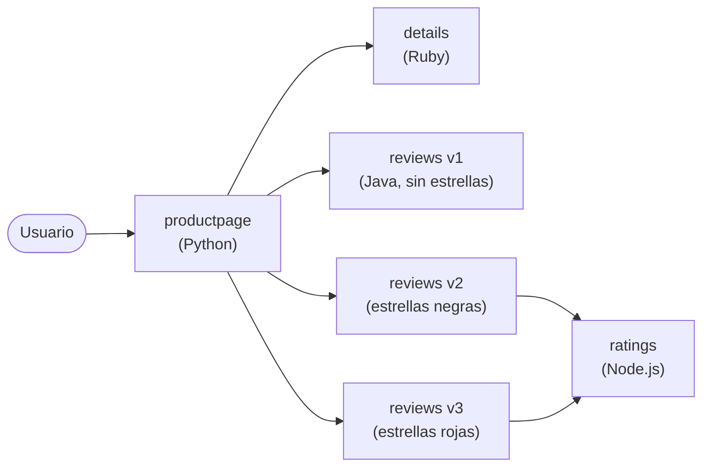

# Instalación, Bookinfo y observabilidad

## 1. Descargar istioctl (sin `curl | sh`)

```bash
V=1.31.3
mkdir -p ~/istio-dl
curl -sfL -o ~/istio-dl/istio-$V-linux-amd64.tar.gz \
  https://github.com/istio/istio/releases/download/$V/istio-$V-linux-amd64.tar.gz
tar -xzf ~/istio-dl/istio-$V-linux-amd64.tar.gz -C ~
mkdir -p ~/.local/bin && ln -sf ~/istio-$V/bin/istioctl ~/.local/bin/istioctl
echo 'export PATH="$HOME/.local/bin:$PATH"' >> ~/.bashrc && source ~/.bashrc
istioctl version --remote=false
```

El curso usa `curl -L https://istio.io/downloadIstio | sh -`, que hace lo mismo.

## 2. Instalar en el clúster

```bash
kubectl config use-context docker-desktop
istioctl x precheck
istioctl install --set profile=demo -y
kubectl label namespace default istio-injection=enabled --overwrite
kubectl get pods -n istio-system
```

### Perfiles

| Perfil | istiod | ingressgateway | egressgateway | Uso |
|---|:-:|:-:|:-:|---|
| `default` | ✔ | ✔ | ✘ | Producción |
| `demo` | ✔ | ✔ | ✔ | Aprender (más logs y trazas) |
| `minimal` | ✔ | ✘ | ✘ | Solo el plano de control |
| `ambient` | ✔ + ztunnel | ✘ | ✘ | Modo sin sidecars |

```bash
istioctl profile list
istioctl profile dump demo
```

## 3. Bookinfo

App de ejemplo con 4 microservicios en lenguajes distintos:



Sin reglas, el Service `reviews` reparte en round robin entre las 3 versiones. Por eso, al
recargar la página, las estrellas cambian.

```bash
cd ~/istio-1.31.3
kubectl apply -f samples/bookinfo/platform/kube/bookinfo.yaml
kubectl get pods                     # esperar 2/2 Running
kubectl exec "$(kubectl get pod -l app=ratings -o jsonpath='{.items[0].metadata.name}')" \
  -c ratings -- curl -sS productpage:9080/productpage | grep -o "<title>.*</title>"
```

### istioctl analyze e IST0102

```bash
istioctl analyze
```

Si se instala Bookinfo en un namespace **sin** `istio-injection`, aparece:

```
Info [IST0102] (Namespace default) The namespace is not enabled for Istio injection.
Run 'kubectl label namespace default istio-injection=enabled' to enable it...
```

Solución: etiquetar el namespace y **recrear** los Pods.

```bash
kubectl label namespace default istio-injection=enabled
kubectl rollout restart deploy
istioctl analyze     # ✔ No validation issues found
```

## 4. Exponer Bookinfo con el gateway

```bash
kubectl apply -f samples/bookinfo/networking/bookinfo-gateway.yaml
kubectl get gateway,virtualservice
kubectl get svc istio-ingressgateway -n istio-system
```

### Acceder desde el navegador de Windows

La EXTERNAL-IP del gateway (`172.19.0.5`) es de la red interna de Docker, así que desde
Windows no se puede abrir directamente. Uso un port-forward:

```bash
kubectl port-forward -n istio-system svc/istio-ingressgateway 8080:80
# http://localhost:8080/productpage
```

En minikube, la alternativa es `minikube tunnel`. En KodeKloud se usa el NodePort.

## 5. Kiali y addons

```bash
kubectl apply -f samples/addons           # Kiali, Prometheus, Grafana, Jaeger
kubectl rollout status deployment/kiali -n istio-system
istioctl dashboard kiali                  # también: grafana | jaeger | prometheus
```

**Kiali** es la consola del mesh. Muestra:
- el **grafo** de servicios con el tráfico en vivo (requests por segundo, errores, latencia),
- la configuración de Istio y su validación (detecta VirtualServices mal hechos),
- si cada workload tiene sidecar.

Kiali saca los datos de **Prometheus**, así que sin tráfico el grafo sale vacío.

### Generar tráfico

```bash
for i in $(seq 1 100); do curl -s -o /dev/null http://localhost:8080/productpage; done
# o continuo:
watch -n 1 curl -s -o /dev/null http://localhost:8080/productpage
```

En Kiali: Graph → namespace `default` → Display: *Traffic Animation*, *Response Time*,
*Security*.

### Simular una falla

```bash
kubectl scale deploy reviews-v3 --replicas=0     # en Kiali, reviews-v3 desaparece del grafo
kubectl scale deploy ratings-v1 --replicas=0     # productpage: "Ratings service is currently unavailable"
kubectl scale deploy reviews-v3 ratings-v1 --replicas=1
```

El grafo de Kiali se pone rojo y naranja cuando hay errores 5xx.

## 6. Limpieza

```bash
kubectl delete -f ~/istio-1.31.3/samples/addons
kubectl delete -f ~/istio-1.31.3/samples/bookinfo/platform/kube/bookinfo.yaml
kubectl delete -f ~/istio-1.31.3/samples/bookinfo/networking/bookinfo-gateway.yaml
istioctl uninstall --purge -y
kubectl delete namespace istio-system
kubectl label namespace default istio-injection-
```
