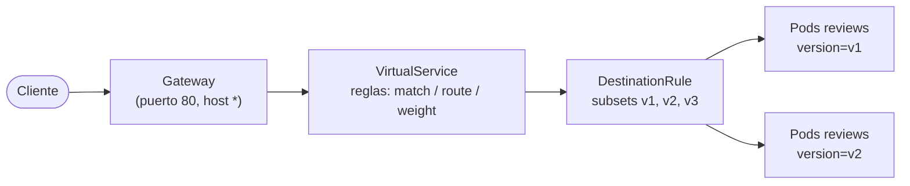

# Traffic Management y Gateways

Los recursos de Istio no reemplazan a los de Kubernetes, sino que se agregan **encima**:

| Recurso | Responde a… |
|---|---|
| **Gateway** | ¿Qué puertos y hosts escucha el Envoy del borde? |
| **VirtualService** | ¿A **dónde** va una petición? (reglas de ruteo) |
| **DestinationRule** | ¿**Cómo** se trata el tráfico una vez elegido el destino? (subsets, balanceo, TLS, circuit breaker) |
| **ServiceEntry** | Agregar servicios externos al registro del mesh |



## Gateway

### ¿Se instala solo o lo agrego yo? Las dos cosas

| Pieza | ¿Se instala con `istioctl install`? |
|---|---|
| **Deployment + Service `istio-ingressgateway`** (el Envoy) | ✔ Sí, con los perfiles `default` y `demo` (no con `minimal`) |
| **Recurso `Gateway`** (qué puertos y hosts escucha) | ✘ No, lo creas tú (por ejemplo, `bookinfo-gateway.yaml`) |
| **`VirtualService`** (a dónde va el tráfico) | ✘ No, lo creas tú |

Sin un `Gateway` y un `VirtualService`, el Envoy está corriendo pero no enruta nada.

```bash
kubectl get deploy,svc -n istio-system      # el componente
kubectl get gateway,virtualservice -A       # la configuración
```

Con la **Gateway API** de Kubernetes (`gateway.networking.k8s.io`) es al revés: al crear el
`Gateway`, Istio despliega el Envoy automáticamente.

```yaml
apiVersion: networking.istio.io/v1
kind: Gateway
metadata:
  name: bookinfo-gateway
spec:
  selector:
    istio: ingressgateway          # en qué Envoy se aplica (el del istio-system)
  servers:
    - port:
        number: 80
        name: http
        protocol: HTTP
      hosts:
        - "bookinfo.app"           # o "*"
```

El Gateway **solo abre el puerto**: no dice a dónde va el tráfico. Para eso se une a un
VirtualService con `gateways:`.

## VirtualService

```yaml
apiVersion: networking.istio.io/v1
kind: VirtualService
metadata:
  name: bookinfo
spec:
  hosts:
    - "bookinfo.app"
  gateways:
    - bookinfo-gateway             # sin esto aplica solo al tráfico interno del mesh (mesh)
  http:
    - match:
        - uri:
            exact: /productpage
        - uri:
            prefix: /static
        - uri:
            prefix: /api/v1/products
      route:
        - destination:
            host: productpage      # nombre del Service de K8s
            port:
              number: 9080
```

Las reglas se evalúan **en orden** y gana la primera que coincide. Conviene dejar una ruta
por defecto (sin `match`) al final.

### Traffic splitting (canary)

```yaml
apiVersion: networking.istio.io/v1
kind: VirtualService
metadata:
  name: reviews
spec:
  hosts:
    - reviews
  http:
    - route:
        - destination:
            host: reviews
            subset: v1
          weight: 90
        - destination:
            host: reviews
            subset: v2
          weight: 10
```

Con Kubernetes "puro", para un 90/10 tendrías que tener 9 Pods v1 y 1 Pod v2. Con Istio el
porcentaje **no depende** del número de réplicas.

### Ruteo por header (usuario de prueba)

```yaml
  http:
    - match:
        - headers:
            end-user:
              exact: jason
      route:
        - destination: { host: reviews, subset: v2 }
    - route:
        - destination: { host: reviews, subset: v1 }
```

## DestinationRule

Define los **subsets** (grupos de Pods por label) y las políticas de tráfico:

```yaml
apiVersion: networking.istio.io/v1
kind: DestinationRule
metadata:
  name: reviews
spec:
  host: reviews
  trafficPolicy:
    loadBalancer:
      simple: ROUND_ROBIN          # RANDOM, LEAST_REQUEST, PASSTHROUGH
  subsets:
    - name: v1
      labels:
        version: v1
    - name: v2
      labels:
        version: v2
      trafficPolicy:               # política solo para este subset
        loadBalancer:
          simple: RANDOM
```

Si un VirtualService usa `subset: v2` y no existe una DestinationRule que lo defina, las
peticiones fallan con **503**. Por eso se aplica primero la DR.

## Archivos de ejemplo en Istio

```bash
cd ~/istio-1.31.3/samples/bookinfo/networking
kubectl apply -f destination-rule-all.yaml
kubectl apply -f virtual-service-all-v1.yaml           # todo a v1
kubectl apply -f virtual-service-reviews-test-v2.yaml  # jason → v2
kubectl apply -f virtual-service-reviews-90-10.yaml
kubectl apply -f virtual-service-reviews-80-20.yaml
kubectl apply -f virtual-service-reviews-50-v3.yaml       # 50% v1 / 50% v3
kubectl apply -f virtual-service-reviews-v3.yaml
kubectl apply -f virtual-service-ratings-test-delay.yaml  # fault injection: delay
kubectl apply -f virtual-service-ratings-test-abort.yaml  # fault injection: abort
kubectl get vs,dr,gw
istioctl analyze
```

## Siguiente en el curso (pendiente)

- [ ] Fault injection (delay / abort)
- [ ] Timeouts y retries
- [ ] Circuit breaking (`connectionPool`, `outlierDetection`)
- [ ] Mirroring
- [ ] ServiceEntry y egress gateway
- [ ] Seguridad: `PeerAuthentication` (mTLS STRICT), `AuthorizationPolicy`
- [ ] Observabilidad: Jaeger, Grafana
