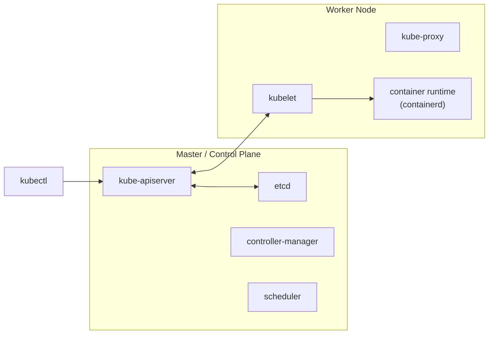

# Arquitectura de Kubernetes

Kubernetes (K8s) es una tecnología de **orquestación de contenedores** creada por Google y
de código abierto.

## ¿Por qué orquestar?

En producción no basta con `docker run`. Hace falta:

1. **Alta disponibilidad**: varias instancias en distintos nodos, para que si cae una
   máquina no caiga la app.
2. **Balanceo de carga** entre contenedores.
3. **Escalado** de instancias en segundos cuando sube la demanda.
4. **Escalado de nodos** (más máquinas) sin bajar la app.
5. Todo **declarativo**, con archivos de configuración.

Desplegar y gestionar contenedores de forma automática es lo que se llama *container
orchestration*.

## Conceptos

- **Node**: máquina física o virtual con Kubernetes instalado, donde corren los
  contenedores. Antes se le llamaba *minion*.
- **Cluster**: conjunto de nodos. Si uno falla, los demás siguen y se reparte la carga.
- **Master / Control plane**: nodo que supervisa el clúster y orquesta los contenedores
  de los workers.

## Componentes



| Componente | Dónde | Función |
|---|---|---|
| **kube-apiserver** | Master | La "puerta de entrada". kubectl, los usuarios y los demás componentes hablan con él. Es lo que **convierte un nodo en master**. |
| **etcd** | Master | Base de datos clave‑valor distribuida donde se guarda todo el estado del clúster. Usa locks para evitar conflictos entre masters. |
| **controller-manager** | Master | "Cerebro": detecta cuando algo se cae (nodos, Pods, endpoints) y reacciona, por ejemplo creando Pods nuevos. |
| **scheduler** | Master | Decide en qué nodo va cada Pod nuevo. |
| **kubelet** | Cada nodo | Agente que se asegura de que los contenedores corran como se espera y reporta el estado del nodo al master. |
| **kube-proxy** | Cada nodo | Implementa las reglas de red de los Services. |
| **container runtime** | Cada nodo | Software que corre los contenedores (containerd, CRI-O…). |

## kubectl

Es la CLI para hablar con el clúster:

```bash
kubectl run hello-minikube --image=...   # desplegar algo
kubectl cluster-info                     # info del clúster
kubectl get nodes                        # nodos (la columna VERSION es la de K8s)
kubectl describe node <nodo>
```

## Docker vs containerd

Resumen histórico:

1. Al principio Kubernetes **solo funcionaba con Docker**.
2. Para soportar otros runtimes (rkt, etc.) se creó la **CRI** (*Container Runtime
   Interface*). Cualquier runtime que cumpla los estándares **OCI** puede usarse:
   - **imagespec**: cómo se construye una imagen.
   - **runtimespec**: cómo debe funcionar un runtime.
3. Docker no implementaba la CRI, así que K8s mantuvo un parche llamado **dockershim**.
4. Docker por dentro ya usaba **containerd**, que sí es compatible con CRI. containerd
   se separó como proyecto propio (graduado en la CNCF).
5. En **Kubernetes 1.24 se eliminó el dockershim**. Kubernetes ya no usa Docker como
   runtime, sino containerd directamente.
6. **Las imágenes hechas con Docker siguen funcionando** porque cumplen el imagespec de
   OCI. Docker no está "muerto": sigue siendo la herramienta más usada para construir
   imágenes.

## CLIs para containerd y CRI

| CLI | Viene de | Para qué |
|---|---|---|
| `ctr` | containerd | Debugging básico. Poco amigable. |
| `nerdctl` | containerd | Uso general. Casi igual que `docker` (`nerdctl run -d -p 80:80 nginx`). Soporta Compose, imágenes cifradas, lazy pulling y firma de imágenes. |
| `crictl` | Kubernetes | Inspeccionar y depurar **cualquier** runtime CRI, desde el punto de vista de Kubernetes. Funciona junto al kubelet. **No** está pensado para crear contenedores. |

```bash
crictl pull busybox
crictl images
crictl ps -a
crictl exec -it <id> ls
crictl logs <id>
crictl pods          # esto no existe en docker: lista Pods
```

crictl busca el runtime en este orden: `dockershim.sock` → `containerd.sock` → `crio.sock`
→ `cri-dockerd.sock`. Se puede forzar con `--runtime-endpoint` o con la variable
`CONTAINER_RUNTIME_ENDPOINT`.

## Montar un clúster de práctica

- **Minikube**: clúster de un solo nodo con todos los componentes juntos. Hoy usa el driver
  `docker`, así que ya no hace falta VirtualBox ni Hyper‑V.
- **kind**: nodos que son contenedores Docker.
- **Docker Desktop**: trae Kubernetes integrado. Es el que uso yo.

Detalle de mi entorno: [00-entorno-local](../00-entorno-local/README.md).
