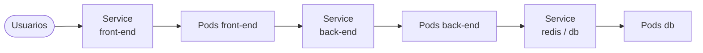

# Networking y Services

## Red de Pods

- En Kubernetes **la IP se asigna al Pod**, no al contenedor.
- Los Pods reciben IPs de una red interna (por ejemplo, `10.244.0.0/16`).
- Esas IPs **cambian** cuando el Pod se recrea, así que no hay que apuntar a ellas.

### Clúster con varios nodos

Si cada nodo tuviera su propia red `10.244.0.0`, dos Pods podrían terminar con la misma IP.
Kubernetes **no configura la red por sí solo**. Exige que se cumplan estas reglas:

1. Todos los Pods pueden hablar con todos los Pods **sin NAT**.
2. Todos los nodos pueden hablar con todos los Pods, y viceversa.

Esto lo resuelve un **plugin de red (CNI)**: Calico, Flannel, Cilium, Weave, VMware NSX‑T,
Cisco ACI, etc. El plugin asigna a cada nodo un rango distinto y configura el ruteo entre
ellos.

---

## Services

Un Service es un **punto de acceso estable** (IP y nombre DNS fijos) para un grupo de Pods,
que se eligen con labels. Desacopla los microservicios entre sí, porque cada uno habla con
el Service y no con IPs de Pods.



### Tipos

| Tipo | Acceso | Uso típico |
|---|---|---|
| **ClusterIP** (default) | Solo dentro del clúster | Comunicación entre microservicios |
| **NodePort** | `IP-del-nodo:30000-32767` | Laboratorios y pruebas |
| **LoadBalancer** | IP externa | Producción en la nube (AKS, EKS, GKE) |

### Los 3 puertos de un NodePort

```
Usuario ──► NodePort (30008) ──► Service port (80) ──► targetPort (80) en el Pod
              en el nodo          ClusterIP del svc       contenedor
```

- **targetPort**: puerto donde escucha la app dentro del Pod. Si no se indica, es igual a `port`.
- **port**: puerto del Service. Es el único obligatorio.
- **nodePort**: puerto en cada nodo, del rango 30000–32767. Si no se indica, se asigna uno
  automáticamente.

```yaml
apiVersion: v1
kind: Service
metadata:
  name: myapp-service
spec:
  type: NodePort
  ports:
    - targetPort: 80
      port: 80
      nodePort: 30008
  selector:              # ← así se conecta con los Pods (copiar sus labels)
    app: myapp
    type: front-end
```

```bash
kubectl apply -f service-definition.yaml
kubectl get svc
kubectl get endpoints myapp-service    # IPs de los Pods que encontró
curl http://<IP-nodo>:30008
```

- Con **varios Pods**, el Service los toma a todos como endpoints y reparte las peticiones.
- Con **varios nodos**, el mismo NodePort se abre en **todos** los nodos.
- Si se agregan o quitan Pods, el Service se actualiza solo.

> ⚠️ Corrección respecto a las notas: decía "Algorithm: Random, SessionAffinity: Yes".
> Con kube-proxy en modo iptables el reparto es aleatorio, pero `sessionAffinity` por
> defecto es **`None`**. Solo es `ClientIP` si lo configuras.

### ClusterIP

```yaml
apiVersion: v1
kind: Service
metadata:
  name: back-end
spec:
  type: ClusterIP        # opcional, es el default
  ports:
    - targetPort: 80
      port: 80
  selector:
    app: myapp
    type: back-end
```

Los otros Pods lo encuentran por **nombre DNS**: `back-end`, o
`back-end.<namespace>.svc.cluster.local`.

### LoadBalancer

Con NodePort, el usuario tendría que conocer `IP-de-cada-nodo:puerto`. Con
`type: LoadBalancer`, en la nube el proveedor crea un balanceador con una IP y un DNS
únicos.

- **En la nube** (AKS, EKS, GKE): funciona directamente.
- **En local**: minikube necesita `minikube tunnel`; Docker Desktop asigna una IP de la
  red de Docker. Desde Windows igual conviene usar `kubectl port-forward`. Ver
  [entorno local](../00-entorno-local/README.md).
- Si no hay proveedor que lo soporte, se comporta como un NodePort.
