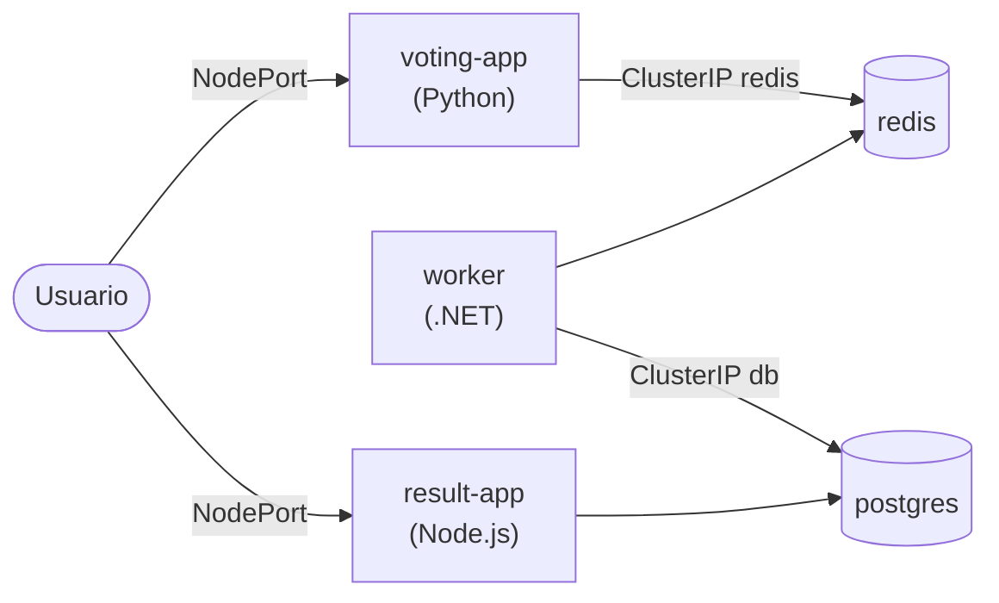

# Práctica: arquitectura de microservicios (voting app)

Repositorio: <https://github.com/kodekloudhub/example-voting-app/tree/master/k8s-specifications>



## Pasos

1. **Desplegar los Pods** (o mejor, Deployments) de cada componente:
   - voting-app: `kodekloud/examplevotingapp_vote:v1`
   - result-app: `kodekloud/examplevotingapp_result:v1`
   - worker: `kodekloud/examplevotingapp_worker:v1`
   - redis: `redis`
   - postgres: `postgres`
2. **Services ClusterIP** para lo interno: `redis` y `db`. El nombre del Service debe ser
   el que la app espera.
3. **Services NodePort** para lo que ve el usuario: `voting-app` y `result-app`.
4. El **worker no necesita Service**: nadie se conecta a él, es él quien se conecta a los
   demás.

Regla para decidir si algo necesita Service: **¿alguien se conecta a él?** Si sí, necesita
uno. ClusterIP si el acceso es interno y NodePort/LoadBalancer si es externo.

## Comandos usados

```bash
kubectl apply -f k8s-specifications/        # todos los YAML de la carpeta
kubectl delete -f k8s-specifications/
kubectl get svc        # svc = services
kubectl get rs         # rs  = replicasets
kubectl scale deployment voting-app-deploy --replicas=3
minikube service voting-service --url       # URL del NodePort en minikube
```

En Docker Desktop, en lugar de `minikube service`, se usa:

```bash
kubectl port-forward svc/voting-service 8080:80
```

---

# Kubernetes en la nube

| Tipo | Quién hace qué | Ejemplos |
|---|---|---|
| **Self‑hosted / Turnkey** | Tú creas y mantienes las VMs (parches, upgrades). Herramientas o scripts montan el clúster. | kops o KubeOne sobre AWS |
| **Hosted / Managed** (Kubernetes as a Service) | El proveedor crea las VMs, instala K8s y gestiona el control plane. Normalmente no tienes acceso a los masters. | **GKE** (Google), **AKS** (Azure), **EKS** (AWS) |
