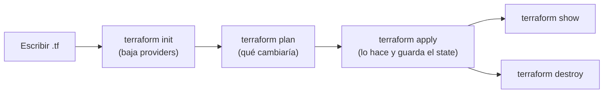

# IaC y fundamentos

## Por qué IaC

Antes la infraestructura se creaba a mano o por consola: era lento, propenso a errores y no
se podía repetir. Con **Infrastructure as Code** la infraestructura queda en archivos
versionados en Git, revisables y reproducibles.

## Tipos de herramientas

| Tipo | Herramientas | Para qué |
|---|---|---|
| **Configuration management** | Ansible, Puppet, Chef, SaltStack | Instalar y configurar software en servidores **que ya existen**. Idempotentes. |
| **Server templating** | Docker, Packer, Vagrant | Crear **imágenes** con todo preinstalado (infraestructura inmutable) |
| **Provisioning** | **Terraform**, CloudFormation | **Crear** la infraestructura (VMs, redes, buckets, DNS…) |

## Terraform

- De HashiCorp. Funciona con **cualquier proveedor** (AWS, Azure, GCP, Kubernetes, GitHub,
  Datadog…) gracias a los **providers**.
- Es **declarativo**: describes el estado final y Terraform calcula qué hacer.
- Guarda lo que creó en el **state** (`terraform.tfstate`).
- Lenguaje: **HCL** (HashiCorp Configuration Language), en archivos `.tf`.

## Sintaxis HCL

```hcl
<bloque> "<tipo_recurso>" "<nombre_local>" {
  argumento = valor
}
```

```hcl
resource "local_file" "pet" {
  filename = "/root/pets.txt"
  content  = "We love pets!"
}
```

- `local_file` = `provider_tipo`: el provider es `local` y el recurso es `file`.
- `pet` es el nombre **dentro de Terraform**. Se referencia como `local_file.pet`.
- Cada tipo de recurso tiene sus propios argumentos (los documenta el provider en el
  Terraform Registry).

## Flujo



## Archivos típicos de un proyecto

| Archivo | Contiene |
|---|---|
| `main.tf` | Los recursos |
| `variables.tf` | Declaración de variables |
| `outputs.tf` | Outputs |
| `provider.tf` / `versions.tf` | Bloques `terraform {}` y `provider {}` |
| `terraform.tfvars` | Valores de las variables |
| `.terraform/` | Providers descargados (no se sube a Git) |
| `.terraform.lock.hcl` | Versiones exactas de los providers (**sí** se sube a Git) |
| `terraform.tfstate` | Estado (no se sube a Git: puede tener secretos) |

Terraform lee **todos** los `.tf` de la carpeta como si fueran uno solo.

## Actualizar y destruir

- Si cambias un argumento que no se puede modificar en sitio (por ejemplo, el contenido de
  un `local_file`), el plan muestra `-/+` → **destroy and recreate**.
- `terraform destroy` borra todo lo que está en el state.
